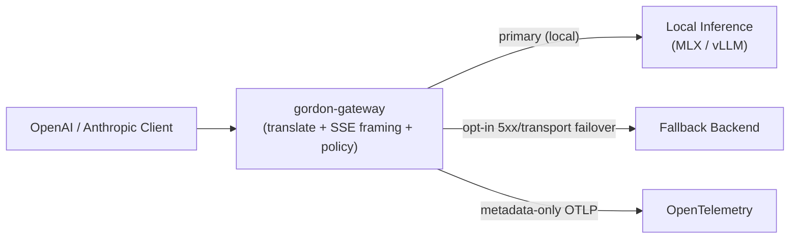
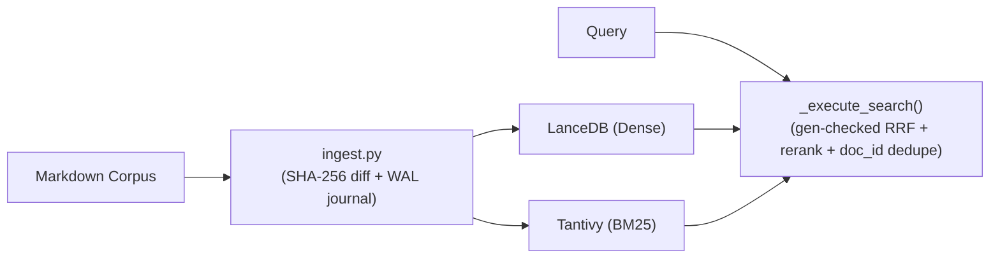
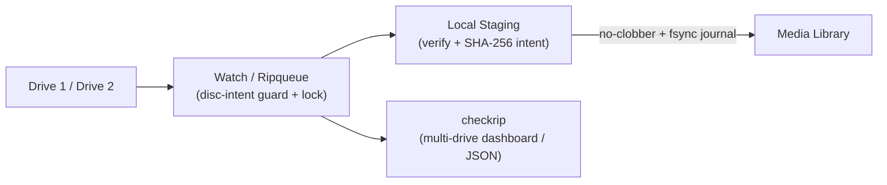

# Trevor Gordon

Senior Technical Customer Success Manager for developer and infrastructure tooling. Previously **Coder**, **Grafana Labs**, and **F5/NGINX**. Based in San Diego.

I design, harden, and operate self-hosted AI serving, retrieval, and automation tooling — focusing on protocol compatibility, failure recovery, and trustworthy offline evaluation. Every featured project below runs locally with synthetic fixtures and zero private credentials or special hardware.

---

## Featured Case Studies (5-Minute Offline Demos)

### 1. [gordon-gateway](https://github.com/trevorgordon981/gordon-gateway) — Multi-Protocol LLM Routing, SSE Integrity & Bounded Failover
- **Problem:** Heterogeneous local (MLX / vLLM) and cloud inference backends diverge on OpenAI vs. Anthropic API formats, CRLF/fragmented SSE framing, reasoning blocks, and error handling — causing silent mid-stream truncation or unintended cloud retries on client `4xx` errors.
- **My contribution vs. upstream:** Built the FastAPI/httpx routing layer, LF/CRLF-safe incremental SSE parser, OpenAI↔Anthropic translation with reasoning/tool parity, trust-boundary failover rules (`4xx` terminal by default; local→external fallback opt-in), and metadata-only OpenTelemetry tracing on top of FastAPI, httpx, and OpenTelemetry SDK.

- **5-minute offline demo & recovery test:**
  ```bash
  git clone https://github.com/trevorgordon981/gordon-gateway.git && cd gordon-gateway
  pip install -r requirements-dev.txt
  python scripts/demo_offline.py
  pytest -q
  ```
- **Verified offline behavior:** Fragmented LF/CRLF and gzip/deflate SSE streams preserve content, reasoning, and tool calls; empty streams, premature EOF, and upstream error frames (even when followed by `[DONE]`) emit explicit error termination instead of `message_stop`; HTTP `400` is terminal by default and trust-boundary config rejects ambiguous types (`47` automated tests in CI).
- **Limits:** Public demo exercises loopback mock backends; live GPU throughput and external OTLP collectors are outside CI scope.

---

### 2. [alfred-rag](https://github.com/trevorgordon981/alfred-rag) — Dual-Store Hybrid Retrieval, Index Lifecycle & Unified Eval
- **Problem:** Hybrid vector + BM25 search stacks quietly drift when documents are deleted or emptied in one store but linger in the other, or when evaluation scripts diverge from the production ranking path.
- **My contribution vs. upstream:** Built the ingestion reconciliation loop (SHA-256 content tracking, write-ahead ingest journal, paired generation/chunk-count markers across LanceDB and Tantivy, embedding cardinality validation, legacy v1→v2 schema migration), unified `/search` and `/search/debug` execution path gated fail-closed (`503`) on inconsistent generations, safe loopback-by-default server with bearer/admin auth, and offline CPU eval harness on top of LanceDB, Tantivy, and FastAPI.

- **5-minute offline demo & recovery test:**
  ```bash
  git clone https://github.com/trevorgordon981/alfred-rag.git && cd alfred-rag
  pip install -r requirements-offline.txt
  python scripts/offline_demo.py
  python -m unittest discover -s tests -v
  ```
- **Verified offline behavior:** Runs real CPU LanceDB + Tantivy against bundled synthetic fixtures (`10/10` labeled queries with verbatim span checks and out-of-domain rejection), verifies `/search` == `/search/debug` rank parity, fails closed (`503`) if stores diverge mid-ingest, and demonstrates deleting/emptying source files removing stale chunks identically from both stores (`30` automated tests in CI).
- **Limits:** Offline CI uses deterministic hash embeddings and lexical reranking; real GPU cross-encoder quality depends on hosted weights outside the public repo.

---

### 3. [burndvd-makemkv](https://github.com/trevorgordon981/burndvd-makemkv) — Crash-Recoverable Multi-Drive Media Automation
- **Problem:** Unattended multi-drive Blu-ray/DVD archiving breaks easily on duplicate-label discs, crashes between file publication and state journaling, and concurrent episode numbering across drives.
- **My contribution vs. upstream:** Built the Python orchestration package (`burndvd`), strict full-title show-intent disc binding for `--watch`, fail-closed pre-hashed publish-intent + no-clobber commit journal, multi-drive hardware-pinned `checkrip` dashboard (versioned `--json`), and parallel decode verification wrapping MakeMKV, ffmpeg, and mkvmerge.

- **5-minute zero-hardware demo & recovery test:**
  ```bash
  git clone https://github.com/trevorgordon981/burndvd-makemkv.git && cd burndvd-makemkv
  pip install -e ".[dev]"
  python examples/synthetic_demo.py
  pytest -q tests/test_dvd_regressions.py
  ```
- **Verified offline behavior:** Rejects unrelated or partial-label discs before staging, replays injected crashes across tested publish/journal boundaries without clobbering or duplicating episodes, isolates duplicate volume labels across drives, and runs `240+` tests on GitHub macOS CI without optical hardware.
- **Limits:** Real disc mastering quirks, network filesystem latency, and macOS Vision subtitle OCR are verified outside headless CI.

---

### Additional Flagship Architecture: [Agentic-Trader](https://github.com/trevorgordon981/Agentic-Trader)
- Deterministic risk-envelope and protective-stop execution architecture with an offline, broker-free proposal-to-close simulation (`python scripts/demo_offline_simulation.py`) and sanitized 2x leveraged-ETF swing execution infrastructure (`swing_executor/`: pluggable signal interface, account-bound SQLite WAL capital reservation ledger, unified immediate-fill/partial-fill reconciliation, fresh-broker cancel-replace stop engine with timeout fail-closed and partial-fill race guards, paper-to-live graduation gates).
- **Boundary:** Demonstrates software engineering safeguards and fail-closed controls — **not** proprietary alpha signals or investment performance claims. Proprietary strategy parameters are intentionally omitted.

---

## Selected Upstream Contributions

| Project | PR / Link | Status | Defect & Exact Contribution |
| --- | --- | --- | --- |
| **MLX-LM** | [ml-explore/mlx-lm#1452](https://github.com/ml-explore/mlx-lm/pull/1452) | **Merged** | Fixed DeepSeek V3.2 sparse-attention LoRA-training crash by stopping gradient propagation through `argpartition` top-k indices (`mlx_lm/models/deepseek_v32.py`). |
| **Axolotl** | [axolotl-ai-cloud/axolotl#3778](https://github.com/axolotl-ai-cloud/axolotl/pull/3778) | **Merged** | Expert-parallel build documentation fix pinning DeepEP to `v1.2.1` where Ampere `DISABLE_NVSHMEM` intranode patches apply cleanly. |
| **MLX-VLM (community fork)** | [ivanfioravanti/mlx-vlm#3](https://github.com/ivanfioravanti/mlx-vlm/pull/3) | **Merged** | Delegated left-padded batch conversion in `to_batch_cache` to custom caches implementing `to_batch()` to fix MiniMax-M3 batched generation. |
| **vMLX** | [jjang-ai/vmlx#49](https://github.com/jjang-ai/vmlx/pull/49) | **Closed (maintainer-attested direct adoption)** | Fixed missing SSM companion-state capture on hybrid cache-hit continuations; maintainer noted direct adoption in `v1.3.29`. |
| **Hermes Agent** | [NousResearch/hermes-agent#50588](https://github.com/NousResearch/hermes-agent/pull/50588), [#50586](https://github.com/NousResearch/hermes-agent/pull/50586) | **Open** | Nonzero CLI error reporting on empty oneshot turns, and transport-aware `cwd` workspace persistence for TUI-created sessions. |

---

## Other Public Repositories & Writing

| Repository | Focus |
| --- | --- |
| [alfred-infra](https://github.com/trevorgordon981/alfred-infra) | Read-only-validated SQLite backups, versioned snapshot retention, secret-scan pre-commit guard, and isolated restore drills (`101` tests in CI). |
| [context-bench](https://github.com/trevorgordon981/context-bench) | Context-window latency & decode throughput benchmark separating buffered single-frame completions from true streaming decode TPS (`python context-bench.py --demo`). |
| [trading-eval-harness](https://github.com/trevorgordon981/trading-eval-harness) | Full-denominator model evaluation harness with failure census, decontamination scanner, calibration gate, and offline demo (`python offline_demo.py`). |
| [options-alpha-bench](https://github.com/trevorgordon981/options-alpha-bench) | Coverage-gated constant-IV Black-Scholes options replay simulator with strict schema validation and offline demo (`python bench.py demo`). |
| [alfred-abliterate](https://github.com/trevorgordon981/alfred-abliterate) | Multi-dimensional refusal/coherence/correctness evaluation and pickle-free provenance-validated activation/direction pipeline. |
| [stackv2-5b-burst](https://github.com/trevorgordon981/stackv2-5b-burst) | Atomic generation-based checkpoint publication, fail-closed transfer gating, and deterministic RNG/data-cursor resume contract. |
| [caymanrepo](https://github.com/trevorgordon981/caymanrepo) | Prototype CLI portfolio tracker with transactional schema-aware CSV import preview, OCC thousandths strike parsing, and cost-basis tests. |

- Writing: [Local AI Stack Saga](https://alooftwaffle.substack.com)
