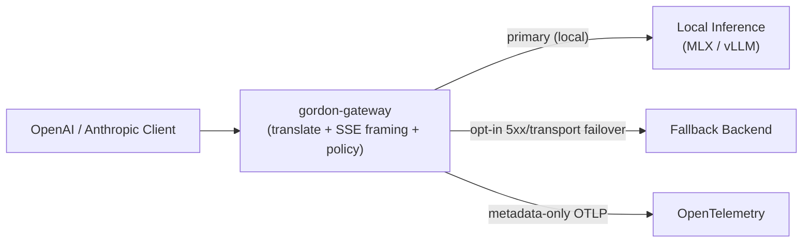
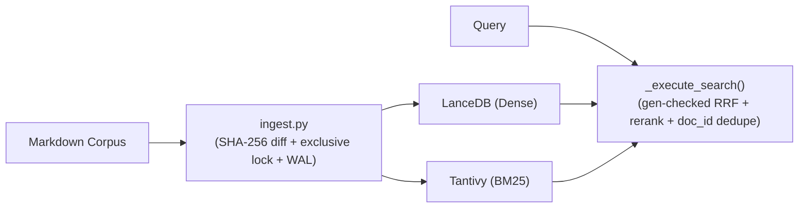
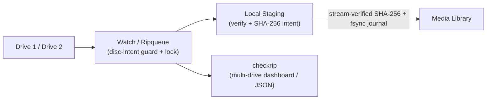

# Trevor Gordon

Enterprise Technical Customer Success & Forward-Deployed Engineering leader for developer and infrastructure tooling (previously **Coder**, **Grafana Labs**, and **F5/NGINX**). Based in San Diego, CA. Open to Senior/Staff Technical CSM, TAM, and FDE roles.

**Contact:** [trevorbgordon@gmail.com](mailto:trevorbgordon@gmail.com) | [LinkedIn](https://www.linkedin.com/in/trevor-gordon-915207115/) | [Substack (Local AI Stack Saga)](https://alooftwaffle.substack.com)

I design, harden, and operate self-hosted AI serving, retrieval, and automation tooling, focusing on protocol compatibility, failure recovery, and trustworthy offline evaluation. Every featured project below runs locally with synthetic fixtures and zero private credentials or special hardware.

---

## Featured Case Studies (5-Minute Offline Demos)

### 1. [gordon-gateway](https://github.com/trevorgordon981/gordon-gateway) ([`v0.1.0`](https://github.com/trevorgordon981/gordon-gateway/releases/tag/v0.1.0)): Multi-Protocol LLM Routing, SSE Integrity & Bounded Failover
- **Problem:** Heterogeneous local (MLX / vLLM) and cloud inference backends diverge on OpenAI vs. Anthropic API formats, CRLF/fragmented SSE framing, reasoning blocks, and error handling, causing silent mid-stream truncation or unintended cloud retries on client `4xx` errors.
- **My contribution vs. upstream:** Built the FastAPI/httpx routing layer, LF/CRLF-safe incremental SSE parser, OpenAI↔Anthropic translation with reasoning/tool parity, trust-boundary failover rules (`4xx` terminal by default; local→external fallback opt-in), and metadata-only OpenTelemetry tracing on top of FastAPI, httpx, and OpenTelemetry SDK.

- **5-minute offline demo & recovery test** *(requires Python 3.11+)*:
  ```bash
  git clone https://github.com/trevorgordon981/gordon-gateway.git && cd gordon-gateway
  python3.11 -m venv .venv && source .venv/bin/activate
  pip install -r requirements-dev.txt
  python scripts/demo_offline.py
  pytest -q
  ```
- **Verified offline behavior:** `5/5` offline demo scenarios pass (`0.61s`) and `58` unit tests (`118` subtests) pass (`0.80s`) on Python 3.11; fragmented LF/CRLF and gzip/deflate SSE streams preserve content, reasoning, and tool calls; empty streams, premature EOF, and upstream error frames (even when followed by `[DONE]`) emit explicit error termination instead of `message_stop`; HTTP `400` is terminal by default and trust-boundary config rejects ambiguous types (verified in GitHub Actions CI).
- **Limits:** Public demo exercises loopback mock backends; live GPU throughput and external OTLP collectors are outside CI scope.

---

### 2. [alfred-rag](https://github.com/trevorgordon981/alfred-rag) ([`v0.1.0`](https://github.com/trevorgordon981/alfred-rag/releases/tag/v0.1.0)): Dual-Store Hybrid Retrieval, Index Lifecycle & Unified Eval
- **Problem:** Hybrid vector + BM25 search stacks quietly drift when documents are deleted or emptied in one store but linger in the other, or when evaluation scripts diverge from the production ranking path.
- **My contribution vs. upstream:** Built the ingestion reconciliation loop (SHA-256 content tracking, write-ahead ingest journal, paired generation/chunk-count markers across LanceDB and Tantivy, exclusive per-corpus writer locking across HTTP and CLI, embedding cardinality validation, legacy v1→v2 schema migration), unified `/search` and `/search/debug` execution path gated fail-closed (`503`) on inconsistent generations, safe loopback-by-default server with bearer/admin auth, and offline CPU eval harness on top of LanceDB, Tantivy, and FastAPI.

- **5-minute offline demo & recovery test** *(requires Python 3.11+)*:
  ```bash
  git clone https://github.com/trevorgordon981/alfred-rag.git && cd alfred-rag
  python3.11 -m venv .venv && source .venv/bin/activate
  pip install -r requirements-offline.txt
  python scripts/offline_demo.py
  python -m unittest discover -s tests -v
  ```
- **Verified offline behavior:** Runs real CPU LanceDB + Tantivy against bundled synthetic fixtures (`10/10` labeled queries, `hit@1 = 9/9`, `MRR = 1.0`, `1/1` out-of-domain rejected, `10/10` `/search` == `/search/debug` parity in `5.27s`; `38/38` unit tests pass in `17.17s`), fails closed (`503`) if stores diverge mid-ingest, blocks concurrent writers (`409` / lock error), and deletes stale chunks identically from both stores (verified in GitHub Actions CI).
- **Limits:** Offline CI uses deterministic hash embeddings and lexical reranking; real GPU cross-encoder quality depends on hosted weights outside the public repo.

---

### 3. [burndvd-makemkv](https://github.com/trevorgordon981/burndvd-makemkv) ([`v0.1.0`](https://github.com/trevorgordon981/burndvd-makemkv/releases/tag/v0.1.0)): Crash-Recoverable Multi-Drive Media Automation
- **Problem:** Unattended multi-drive Blu-ray/DVD archiving breaks easily on duplicate-label discs, crashes between file publication and state journaling, and concurrent episode numbering across drives.
- **My contribution vs. upstream:** Built the Python orchestration package (`burndvd`), strict full-title show-intent disc binding for `--watch`, stream-verified SHA-256 publish-intent + no-clobber commit journal, multi-drive hardware-pinned `checkrip` dashboard (versioned `--json`), and parallel decode verification wrapping MakeMKV, ffmpeg, and mkvmerge.

- **5-minute zero-hardware demo & recovery test** *(requires Python 3.11+)*:
  ```bash
  git clone https://github.com/trevorgordon981/burndvd-makemkv.git && cd burndvd-makemkv
  python3.11 -m venv .venv && source .venv/bin/activate
  pip install -e ".[dev]"
  python examples/synthetic_demo.py
  pytest -q tests/test_dvd_regressions.py
  ```
- **Verified offline behavior:** Synthetic demo passes in `0.28s` and `322` tests pass (`6` skipped, `0` failed) on Python 3.11 / macOS CI; rejects unrelated or partial-label discs before staging, verifies copied bytes against the durable publish-intent SHA-256 before no-clobber rename, replays injected crashes across tested publish/journal boundaries without clobbering or duplicating episodes, and isolates duplicate volume labels and busy drive slots across drives.
- **Limits:** Real disc mastering quirks, network filesystem latency, and macOS Vision subtitle OCR are verified outside headless CI.

---

### Additional Flagship Architecture: [Agentic-Trader](https://github.com/trevorgordon981/Agentic-Trader) ([`v0.1.0`](https://github.com/trevorgordon981/Agentic-Trader/releases/tag/v0.1.0))
- Deterministic risk-envelope and protective-stop execution architecture with an offline, broker-free proposal-to-close simulation (`python3.11 -m venv .venv && source .venv/bin/activate`, `python scripts/demo_offline_simulation.py` passes in `0.48s`; `4,369` tests pass on Python 3.12 CI) and sanitized 2x leveraged-ETF swing execution infrastructure (`swing_executor/`: pluggable signal interface, account-bound SQLite WAL capital reservation ledger, unified immediate/partial/deferred-fill reconciliation with idempotent GTC stop arming, fresh-broker cancel-replace stop engine with timeout fail-closed and partial-fill race guards, paper-to-live graduation gates).
- **Boundary:** Demonstrates software engineering safeguards and fail-closed controls, **not** proprietary alpha signals or investment performance claims. Proprietary strategy parameters are intentionally omitted.

---

## Merged & Adopted Upstream Contributions

| Project | PR / Link | Status | Defect & Exact Contribution |
| --- | --- | --- | --- |
| **MLX-LM** | [ml-explore/mlx-lm#1452](https://github.com/ml-explore/mlx-lm/pull/1452) | **Merged** | Fixed DeepSeek V3.2 sparse-attention LoRA-training crash by stopping gradient propagation through `argpartition` top-k indices (`mlx_lm/models/deepseek_v32.py`). |
| **Axolotl** | [axolotl-ai-cloud/axolotl#3778](https://github.com/axolotl-ai-cloud/axolotl/pull/3778) | **Merged** | Expert-parallel build documentation fix pinning DeepEP to `v1.2.1` where Ampere `DISABLE_NVSHMEM` intranode patches apply cleanly. |
| **MLX-VLM (community fork)** | [ivanfioravanti/mlx-vlm#3](https://github.com/ivanfioravanti/mlx-vlm/pull/3) | **Merged** | Delegated left-padded batch conversion in `to_batch_cache` to custom caches implementing `to_batch()` to fix MiniMax-M3 batched generation. |
| **vMLX** | [jjang-ai/vmlx#49](https://github.com/jjang-ai/vmlx/pull/49) | **Adopted (`v1.3.29`)** | Fixed missing SSM companion-state capture on hybrid cache-hit continuations; maintainer noted direct adoption in `v1.3.29`. |

---

## Other Public Repositories & Writing

| Repository | Focus |
| --- | --- |
| [alfred-infra](https://github.com/trevorgordon981/alfred-infra) ([`v0.1.0`](https://github.com/trevorgordon981/alfred-infra/releases/tag/v0.1.0)) | Self-hosted cluster monitoring, custom Apple Silicon M3 serving engine & authenticated LAN proxy, read-only-validated SQLite backups, fail-closed secret scanning, and isolated `age`-encrypted restore drills (`109/109` tests pass across 3 CI workflows). |
| [context-bench](https://github.com/trevorgordon981/context-bench) ([`v0.1.0`](https://github.com/trevorgordon981/context-bench/releases/tag/v0.1.0)) | Context-window latency & decode throughput benchmark separating buffered completions from streaming decode TPS and tracking observed prompt + output totals (`python context-bench.py --demo`; `53/53` tests pass). |
| [trading-eval-harness](https://github.com/trevorgordon981/trading-eval-harness) ([`v0.1.0`](https://github.com/trevorgordon981/trading-eval-harness/releases/tag/v0.1.0)) | Full-denominator model evaluation harness with strict unique case IDs, failure census, decontamination scanner, calibration gate, and offline demo (`python offline_demo.py`; `50/50` tests + `4/4` calibration fixtures pass). |
| [options-alpha-bench](https://github.com/trevorgordon981/options-alpha-bench) ([`v0.1.0`](https://github.com/trevorgordon981/options-alpha-bench/releases/tag/v0.1.0)) | Coverage-gated constant-IV Black-Scholes options replay simulator with trading-session chronology, frozen price-snapshot provenance, and offline demo (`python bench.py demo`; `48/48` tests pass). |
| [alfred-abliterate](https://github.com/trevorgordon981/alfred-abliterate) ([`v0.1.0`](https://github.com/trevorgordon981/alfred-abliterate/releases/tag/v0.1.0)) | Multi-dimensional refusal/coherence/correctness evaluation and SIGKILL-safe, pickle-free provenance-validated activation/direction pipeline with loader revision enforcement (`50/50` tests pass). |
| [stackv2-5b-burst](https://github.com/trevorgordon981/stackv2-5b-burst) ([`v0.1.0`](https://github.com/trevorgordon981/stackv2-5b-burst/releases/tag/v0.1.0)) | Atomic generation-based checkpoint publication, lock-serialized monotonic `LATEST.json` pointer swaps, fail-closed transfer gating, and deterministic RNG/data-cursor resume contract (`37/37` tests pass). |

- Writing: [Local AI Stack Saga](https://alooftwaffle.substack.com)
